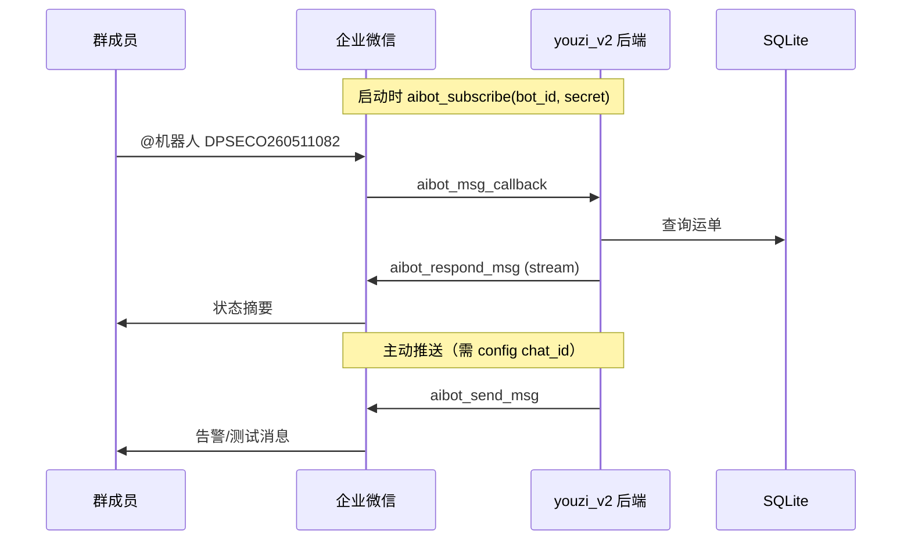

# 企业微信智能机器人（Youzi 集成）

Youzi v2 通过仓库根 `config/config.json` 的 `wecom_webhook` 块对接企业微信，支持 **主动推送** 与 **群内 @ 查运单**。凭证仅保存在本地配置，**禁止**写入业务代码或提交 Git。

## 目录

- [能力概览](#能力概览)
- [两种接入方式](#两种接入方式)
- [推荐：智能机器人长连接](#推荐智能机器人长连接)
- [配置说明](#配置说明)
- [启动与日志](#启动与日志)
- [获取 chat_id（主动推送）](#获取-chat_id主动推送)
- [@ 机器人查运单](#-机器人查运单)
- [主动推送测试 API](#主动推送测试-api)
- [代码与架构](#代码与架构)
- [故障排查](#故障排查)
- [官方文档](#官方文档)

## 能力概览

| 能力 | 长连接（bot_id + secret） | Webhook（key / url） |
|------|---------------------------|----------------------|
| 后端启动自动连企微 | ✅ 常驻 WebSocket | ❌ 无需连接 |
| 群内 @ 后回复运单状态 | ✅ | ❌ |
| 主动推送到群/单聊 | ✅（需 `chat_id`） | ✅ |
| 记录 `chat_id` 到本地日志 | ✅ | — |

当前 Youzi 已实现：

1. **长连接守护**：`wss://openws.work.weixin.qq.com` → `aibot_subscribe` → 心跳 → 处理回调。
2. **@ 查运单**：解析 `DPSECO…` 运单号，查 `youzi_v2/data/youzi_v2.db`，`aibot_respond_msg` + stream 回复。
3. **主动推送**：`aibot_send_msg` 或 Webhook HTTP POST；测试接口见下文。
4. **订阅更新推送**：运单列表「订阅」后，内部/承运商轨迹变化或 ETA 到港每日提醒写入顶栏通知时，同步推送到 `chat_id` 群/单聊（需 `subscription_push_enabled` 未关闭）。

## 两种接入方式

### 方式 A · 消息推送 Webhook（原「群机器人」）

- 企微后台创建 **消息推送**，获得 `https://qyapi.weixin.qq.com/cgi-bin/webhook/send?key=...`。
- Youzi 只保存 `key` 或完整 `url`，单向 POST 文本/Markdown。
- **不能**收 @、不能查运单回调。

参考：[消息推送配置说明](https://developer.work.weixin.qq.com/document/path/99110)

### 方式 B · 智能机器人长连接（当前主推）

- 企微后台创建 **智能机器人**，API 模式选 **长连接**，获得 **BotID**、**Secret**。
- Youzi 后端启动后维持 WebSocket，可收消息回调并回复，也可主动推送。

参考：[智能机器人长连接](https://developer.work.weixin.qq.com/document/path/101463)

## 推荐：智能机器人长连接



**注意**

- 同一 Bot **全局仅允许一条**长连接；请勿多实例/多进程同时用同一 `bot_id`。
- 主动推送前，用户须在该 **群或单聊** 内先与机器人有过互动（企微限制）。
- 被动回复须透传回调里的 `headers.req_id`，正文使用 **stream**（`finish: true` 一次性回复），见官方 101463。

## 配置说明

文件路径：**仓库根** `config/config.json`（gitignore）。

### 智能机器人（完整示例）

```json
"wecom_webhook": {
  "bot_id": "<BotID>",
  "secret": "<Secret>",
  "chat_id": "<群或单聊 chatid>",
  "chat_type": 2,
  "enabled": true,
  "long_connection": true,
  "shipment_query_enabled": true,
  "ws_url": "wss://openws.work.weixin.qq.com"
}
```

| 字段 | 必填 | 默认 | 说明 |
|------|------|------|------|
| `bot_id` | 长连接是 | — | 智能机器人 BotID |
| `secret` | 长连接是 | — | 长连接专用 Secret（非回调 Token） |
| `chat_id` | 主动推送是 | — | 推送目标会话；@ 查单可不填 |
| `chat_type` | 否 | `2` | `1` 单聊，`2` 群聊 |
| `enabled` | 否 | 有凭证则为 `true` | 设为 `false` 关闭全部企微能力 |
| `long_connection` | 否 | `true` | `false` 时不启动守护（也无法 @ 查单） |
| `shipment_query_enabled` | 否 | `true` | `false` 关闭 @ 查运单 |
| `shipment_query_refresh` | 否 | `true` | `false` 时查单不拉 DPS/轨迹，仅读本地库 |
| `subscription_push_enabled` | 否 | 与 `enabled` 一致 | `false` 时不把运单订阅更新推到企微（顶栏铃铛仍保留） |
| `ws_url` | 否 | 官方默认 wss 地址 | 私有部署以管理端显示为准 |
| `timeout` | 否 | `15` | Webhook HTTP 超时（秒） |

配置 `bot_id` + `secret` 时 **不必**再写 `enabled: true`（默认可用）。

### Webhook 仅推送（示例）

```json
"wecom_webhook": {
  "enabled": true,
  "key": "<Webhook 密钥>"
}
```

或 `"url": "https://qyapi.weixin.qq.com/cgi-bin/webhook/send?key=..."`。

## 启动与日志

1. 安装依赖（含 `websocket-client`）：

   ```bash
   pip install -r youzi_v2/requirements.txt
   ```

2. 启动后端（与日常一致）：

   ```bash
   uvicorn youzi_v2.app:app --host 0.0.0.0 --port 3001 --reload
   ```

3. 启动成功标志（控制台或日志文件）：
   - `长连接守护线程已启动…`
   - `aibot_subscribe 认证成功…`

**运行日志**（勿提交 Git）：

| 文件 | 内容 |
|------|------|
| `youzi_v2/logs/wecom-aibot-YYYY-MM-DD.log` | 连接、认证、chat_id、查单、错误 |

## 获取 chat_id（主动推送）

1. 确保 `long_connection: true` 且后端已 **认证成功**。
2. 在 **目标群** 内 @智能机器人 发任意消息。
3. 打开当日 `wecom-aibot-*.log`，查找类似：

   ```text
   发现 chat_id=wrxxxxxxxx chat_type=group cmd=aibot_msg_callback → 写入 config.json wecom_webhook.chat_id
   ```

4. 将 `chat_id` 写入 `config.json`，**重启后端**（若仅改 chat_id，重启后推送即生效）。

## @ 机器人查运单

**用法**

- 在群内 @机器人，发送查询关键字，例如：
  - 运单号：`DPSECO260511082`
  - 货件号：`FBA19FN8FN6C`
  - 客户编号：`ORD-2026-001`
  - 多条：`DPSECO260511082 FBA19FN8FN6C`（空格/逗号分隔）
  - **运单明细**：消息中同时带单号且含 **「明细」**（如 `DPSECO260511082 明细`）→ 回复与运单列表 **复制 → 运单明细** 相同：`运单号 = 货件号 = 仓库（空则邮编）= Nctns`，不含转单号行；**不**触发查单前 DPS/轨迹同步（只读本地库）
- 单次最多 **5** 个关键字；**每个关键字**只走一条查找链：**运单号 → 货件号 → 客户编号** 依次精确匹配，**任一命中即返回**，不会对三个字段各查一遍再合并（同档多条取 `updated_time` 最新）。

**回复字段**（每条运单一块，以 `【运单号】` 开头；**无值的行不展示**）

| 字段 | 来源 |
|------|------|
| 客户 | `customer` |
| 客户编号 / 货件号 | 两者相同时只展示货件号 |
| 渠道 | 渠道中文名或代码 |
| 转运状态 / 明细状态 | `status_code`、`route_status`（先粗后细） |
| 最新内部轨迹 + 轨迹时间 | `latest_tracking_desc` / `latest_tracking_time` |
| 最新承运商轨迹 + 轨迹时间 | `latest_carrier_desc` / `latest_carrier_time` |
| 派送仓库 / 邮编 / 件数 / 转单号 | `address_code`、`zipcode`、`ctns`、`tracking_number` |

**查单时同步**（默认 `shipment_query_refresh: true`；**不含**带「明细」的运单明细回复）：对每个命中的运单依次尝试

1. DPS 明细状态 → 回写 `route_status`（需 `waybill_id` 与 `config.json` 中 `dps_route_status_query`）
2. 内部轨迹 → `config.json` `base_url`
3. 承运商轨迹 → `config.json` `vendors`

同步失败只记 `wecom-aibot-*.log`，仍返回当前库内数据。关闭刷新：`"shipment_query_refresh": false`。

关闭查单：`"shipment_query_enabled": false`。

## 主动推送测试 API

```bash
curl -X POST "http://127.0.0.1:3001/api/v1/notifications/wecom/test" \
  -H "Content-Type: application/json" \
  -d "{\"content\":\"Youzi 企业微信连通测试\"}"
```

- Body 可选；省略 `content` 时使用默认测试文案。
- 长连接模式需已配置 `chat_id`，且守护 **is_ready**。
- 索引见 [api.md](./api.md#统计与计划任务) 中 `POST /api/v1/notifications/wecom/test`。

## 代码与架构

| 模块 | 路径 | 职责 |
|------|------|------|
| 配置与统一发送 | `services/wecom_webhook.py` | 读 config；Webhook / 长连接发送入口 |
| WebSocket 帧 | `services/wecom_aibot_ws.py` | 认证、stream 体、临时会话发送 |
| 长连接守护 | `services/wecom_aibot_runtime.py` | 连接、心跳、回调、回复队列 |
| 运行日志 | `services/wecom_aibot_log.py` | 写入 `logs/wecom-aibot-*.log` |
| @ 查运单 | `services/wecom_aibot_shipment_query.py` | 解析单号、组回复文案 |
| 查单刷新 | `services/wecom_aibot_shipment_refresh.py` | 查单前同步明细状态与轨迹 |
| 订阅推送 | `services/wecom_subscription_push.py` | 订阅轨迹/ETA 提醒写通知后推企微 |
| 启动挂载 | `app.py` | `startup` → `start_wecom_aibot_runtime` |

单元测试：

```bash
python -m unittest youzi_v2.tests.test_wecom_webhook youzi_v2.tests.test_wecom_aibot_runtime youzi_v2.tests.test_wecom_aibot_shipment_query
```

## 故障排查

| 现象 | 可能原因 | 处理 |
|------|----------|------|
| 无「认证成功」 | `bot_id`/`secret` 错误、网络 | 查日志 errcode；核对企微后台 |
| @ 后无回复 | 守护未就绪、查单被关 | 看日志「收到查单消息」；确认 `shipment_query_enabled` |
| 查询失败 / 数据库 | 路径或库不存在 | 确认 `youzi_v2/data/youzi_v2.db` 存在且有该运单 |
| 主动推送 400 | 未配 `chat_id` | 按上文从日志取 chat_id |
| 推送 502 / errcode | 会话未激活、chat_id 错 | 群内先 @ 机器人再推；核对 `chat_type` |
| 连接频繁断开 | 多实例抢同一 bot | 只保留一个后端进程 |
| 临时连踢掉守护 | 已禁用：常驻模式不再临时连 | 确保 `long_connection: true` |

## 官方文档

- [智能机器人长连接（101463）](https://developer.work.weixin.qq.com/document/path/101463) — BotID、Secret、回调、`aibot_respond_msg`、`aibot_send_msg`
- [消息推送 Webhook（99110）](https://developer.work.weixin.qq.com/document/path/99110) — 仅推送场景

## 相关文档

- 部署与私密配置摘要：[deployment.md](./deployment.md#私密配置)
- API 索引：[api.md](./api.md)
- 业务服务说明：[../services/README.md](../services/README.md)
